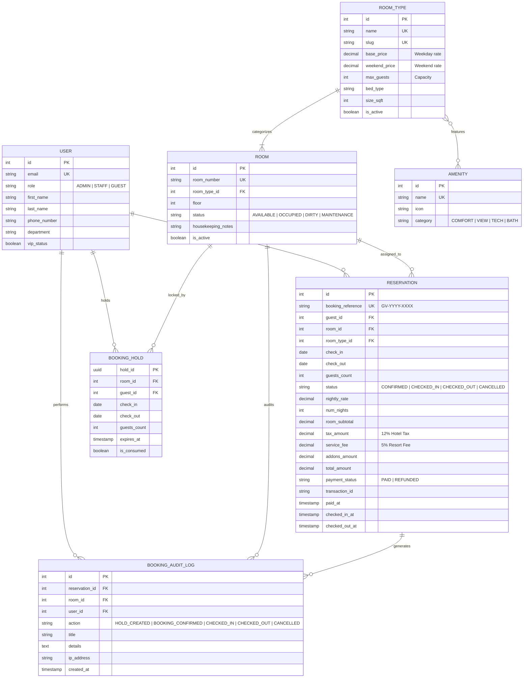

# GrandView Luxury Hotel & Resort — PMS & Reservation System

[](https://react.dev)
[](https://python.org)
[](https://djangoproject.com)
[](#architecture--separation-of-concerns)
[](#restful-api--swagger-documentation)
[](#running-automated-acceptance-tests)

**GrandView Luxury Hotel & Resort** is an enterprise-grade Property Management System (PMS) and customer-facing reservation platform engineered for hotel booking operations. It features a modern, responsive **React 18 Single Page Application (SPA)** with real-time state management, backed by a robust Django 5 REST engine enforcing strict transactional data integrity.

---

## Key Differentiators & Architecture

### 1. 15-Minute Inventory Hold & Anti-Double-Booking Engine
To eliminate race conditions when multiple customers view the same room:
* When a guest proceeds to checkout, the system places a **15-Minute Temporary Hold** (`BookingHold`) on that physical room.
* During this window, no other guest can reserve or hold this room.
* A live countdown timer updates in the guest UI.
* **Automatic Expiry**: Expired holds (`expires_at < timezone.now()`) automatically cease blocking availability without requiring manual cron jobs.

### 2. ACID Transactional Integrity & Pessimistic Row Locking
```python
with transaction.atomic():
    locked_room = Room.objects.select_for_update().get(id=room_id)
    overlapping = Reservation.objects.filter(
        room=locked_room,
        status__in=[Reservation.Status.CONFIRMED, Reservation.Status.CHECKED_IN],
        check_in__lt=check_out,
        check_out__gt=check_in
    )
    if overlapping.exists():
        raise BookingConflictError("Room is already reserved for the selected dates.")
```
* Uses database-level row locking (`select_for_update()`) inside an atomic transaction.
* Database-level `CheckConstraint` enforces `check_out > check_in`.
* A compound index on `[room, check_in, check_out, status]` ensures sub-millisecond overlap queries.

### 3. Server-Side Role-Based Access Control (RBAC)
Security is enforced on the server, never solely by hiding buttons in HTML:
* **Hotel Administrator (`ADMIN`)**: Room & Rate administration (CRUD room types & rooms), system-wide revenue analytics, immutable audit logs.
* **Front Desk Staff (`STAFF`)**: Real-time arrival/departure management, 1-click physical key handover (Check-In), checkout transitions, and housekeeping status board.
* **Registered Guest (`GUEST`)**: Search availability, place temporary holds, pay via sandbox gateway, view printable confirmation vouchers, and cancel bookings.

### 4. Operations & Revenue Intelligence
Real-time operational KPIs computed directly from reservation ledgers:
* **Occupancy Rate (%)**: $\frac{\text{Occupied Room Nights}}{\text{Total Available Room Nights}} \times 100$
* **ADR (Average Daily Rate)**: $\frac{\text{Gross Room Revenue}}{\text{Occupied Room Nights Sold}}$
* **RevPAR (Revenue Per Available Room)**: $\frac{\text{Gross Room Revenue}}{\text{Total Available Inventory Nights}}$
* **Housekeeping Turnover Board**: Floor-by-floor room grid with 1-click status transitions (`AVAILABLE` $\leftrightarrow$ `DIRTY` $\leftrightarrow$ `MAINTENANCE`).

---

## Entity-Relationship (ER) Diagram



---

## Quickstart & Local Setup

### 1. Clone & Activate Environment
```powershell
# Navigate to the project directory
cd CoServe

# Activate Python virtual environment (Windows PowerShell)
.\venv\Scripts\Activate.ps1
```

### 2. Apply Database Migrations & Seed Demo Records
```powershell
# Apply database migrations
python manage.py migrate

# Seed luxury rooms, rates, demo accounts, and active reservation history
python manage.py seed_hotel_data
```

### 3. Launch Development Server
* **Option A: Full-Stack React SPA (Served by Django at port 8000)**:
  ```powershell
  python manage.py runserver 127.0.0.1:8000
  ```
  Visit **`http://127.0.0.1:8000/`** in your browser. (The production React 18 build is bundled and served directly by Django).

* **Option B: Vite React Live Development Server (Port 5173 with HMR)**:
  ```powershell
  cd frontend
  npm run dev
  ```
  Visit **`http://localhost:5173/`** in your browser (proxies all API calls to Django).

---

## Demo Accounts & 1-Click Role Switcher

For seamless evaluation, every page features a top **Reviewer Demo Switcher Bar**, and the login screen (`/accounts/login/`) provides **1-Click Instant Sign-In Buttons**:

| Role | Email | Password | Permissions & Views Accessible |
|---|---|---|---|
| **Hotel Administrator** | `admin@grandview.com` | `adminpassword123` | Room & Rate CRUD (`/rooms/types/`), Operations Dashboard (`/reports/dashboard/`), Audit Log (`/bookings/admin/audit-trail/`) |
| **Front Desk Staff** | `staff@grandview.com` | `staffpassword123` | Reception Desk (`/bookings/staff/desk/`), Check-In / Check-Out, Housekeeping Board (`/reports/housekeeping/`), Room Inventory |
| **Primary Guest** | `guest@example.com` | `guestpassword123` | Search, Hold room, Sandbox payment, View Voucher, My Stays (`/bookings/my-bookings/`), Cancel reservation |
| **Secondary Guest** | `sarah@example.com` | `guestpassword123` | Used to demonstrate concurrency rejection and multi-guest isolation |

---

## Principal User Journeys Demonstrated

### Guest Experience
1. **Search Availability**: Navigate to `/bookings/search/` and select stay dates (e.g., tomorrow for 2 nights) and guest count.
2. **Temporary Hold**: Click **"Reserve & Hold for 15 Min"**. A countdown timer starts on the checkout page.
3. **Itemized Billing**: View base rate, night count, 12% Hotel Tax, 5% Resort Fee, and optional amenities (Breakfast buffet, Airport shuttle).
4. **Sandbox Payment**: Review the pre-filled dummy test card (`4242 4242 4242 4242`) and click **"Authorize & Confirm Reservation"**.
5. **Confirmation Voucher**: Generates unique reference (e.g., `GV-2026-X8Y2`) with printable receipt.
6. **Guest Portal & Cancellation**: Visit `/bookings/my-bookings/` to view upcoming stays or cancel a reservation with instant refund logging.

### Front Desk Staff Experience
1. Navigate to `/bookings/staff/desk/`.
2. View **Today's Arrivals**, **Today's Departures**, and **In-House Guests**.
3. Click **"Check In"** on an arriving guest: transitions reservation to `CHECKED_IN`, marks physical room `OCCUPIED`, and records an audit log.
4. Click **"Check Out"** on departing guest: transitions reservation to `CHECKED_OUT`, marks physical room `DIRTY` (needs housekeeping), and frees room for turnover.
5. Visit `/reports/housekeeping/` to view the floor board and click **"Mark Clean & Ready"** to return room to `AVAILABLE`.

### Hotel Administrator Experience
1. Navigate to `/reports/dashboard/` to view Occupancy %, Gross Revenue, ADR, RevPAR, and day-by-day performance.
2. Navigate to `/rooms/types/` to adjust weekday base rates or weekend pricing.
3. Navigate to `/bookings/admin/audit-trail/` to inspect immutable logs of every business event.

---

## RESTful API & Swagger Documentation

The platform includes a REST API documented with OpenAPI 3.0:
* **Interactive Swagger UI**: Visit **`http://127.0.0.1:8000/api/docs/`** to test endpoints interactively in the browser.
* **OpenAPI 3.0 JSON Spec**: Available at **`http://127.0.0.1:8000/api/openapi.json`**.

### Key Endpoints:
| Method | Endpoint | Description |
|---|---|---|
| `GET` | `/api/v1/rooms/` | List all active room categories with specs & pricing |
| `GET` | `/api/v1/availability/?check_in=...&check_out=...&guests=2` | Query operational available rooms |
| `POST` | `/api/v1/holds/` | Place a 15-minute temporary hold on a room (`{"room_id": 1, ...}`) |
| `POST` | `/api/v1/bookings/` | Confirm booking with hold token and simulated payment |
| `GET` | `/api/v1/bookings/{reference}/` | Retrieve reservation voucher and financial breakdown |
| `POST` | `/api/v1/bookings/{reference}/cancel/` | Cancel booking and release room inventory |
| `POST` | `/api/v1/bookings/{reference}/check-in/` | Front desk guest check-in action |
| `POST` | `/api/v1/bookings/{reference}/check-out/` | Front desk guest check-out action |
| `GET` | `/api/v1/reports/operations/?start_date=...&end_date=...` | Retrieve occupancy rate, ADR, RevPAR, and revenue |

---

## Running Automated Acceptance Tests

To execute the test suite:
```powershell
python manage.py test apps.bookings
```

### Verified Acceptance Scenarios (9/9 Passed):
1. `test_guest_search_and_successful_booking`: Validates availability discovery, 15-minute hold creation, and payment confirmation.
2. `test_overlapping_booking_rejection`: Validates that a concurrent overlapping request for the same room is blocked with `BookingConflictError`.
3. `test_invalid_dates_handling`: Validates rejection of check-out $\le$ check-in, past dates, and stays $>90$ days.
4. `test_expired_holds_do_not_block_inventory`: Confirms expired holds automatically release rooms.
5. `test_cancellation_releases_inventory`: Confirms cancellation transitions status and returns the room to available inventory.
6. `test_staff_check_in_and_check_out_lifecycle`: Confirms `CONFIRMED` $\to$ `CHECKED_IN` (Room: `OCCUPIED`) $\to$ `CHECKED_OUT` (Room: `DIRTY`).
7. `test_operations_report_matches_reservations`: Confirms occupancy rate and revenue math match the underlying database records.
8. `test_server_side_rbac_enforcement`: Confirms HTTP 403 Forbidden on unauthorized administrative endpoints.
9. `test_rest_api_availability_and_booking_journey`: Validates availability, hold, confirmation, and conflict rejection over JSON REST endpoints.

---

## Assumptions & Known Limitations

1. **Simulated Payments**: In compliance with the project guidelines, credit card and UPI transactions run in test sandbox mode without external charges.
2. **Local Deployment**: The application is configured by default for zero-setup local execution using SQLite with WAL mode. For cloud deployment, PostgreSQL can be connected via the `DATABASE_URL` environment variable.
3. **Keycard Encoding**: Physical RFID door key encoders are abstracted by the software digital check-in confirmation.
