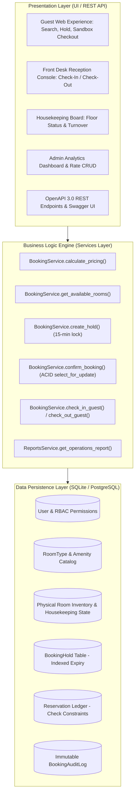
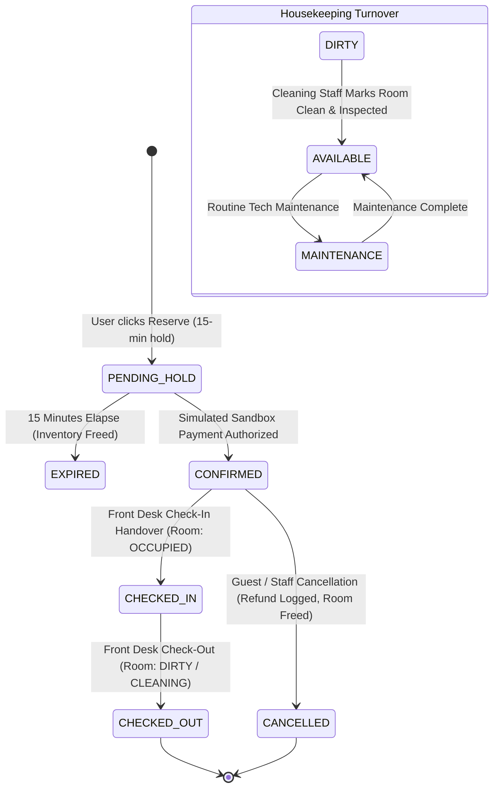

# Technical Engineering Report: GrandView Hotel Management & Reservation System

**Author:** Technical Engineering Candidate  
**Domain Assignment:** Hotel Booking  
**Stack:** Python 3.13 / Django 5.1 / SQLite (ACID) / Tailwind CSS / HTMX / OpenAPI 3.0  

---

## 1. Executive Summary

GrandView Hotel Management System is a database-backed web application built to address the operational and transaction-processing requirements of the hospitality industry. The system fulfills two primary objectives:
1. Providing guests with an intuitive, transparent booking experience that guarantees inventory availability through automated temporary holds and instant confirmations.
2. Equipping hotel staff and executive leadership with real-time operational oversight—including a front-desk arrivals/departures console, a housekeeping turnover board, dynamic rate administration, and audited revenue/occupancy analytics.

The application follows a **Modular Monolith** architecture that enforces strict separation of concerns between user interface presentation, business logic services, and persistence models.

---

## 2. Architecture & Separation of Concerns



### Modular Domain Segregation
* `apps.accounts`: Custom `User` model with database-enforced roles (`ADMIN`, `STAFF`, `GUEST`) and `@hotel_admin_required`, `@hotel_staff_required` view decorators.
* `apps.rooms`: Room types, physical room numbers, floor layout, housekeeping status (`AVAILABLE`, `OCCUPIED`, `DIRTY`, `MAINTENANCE`), and amenities.
* `apps.bookings`: Reservation state machine, 15-minute temporary holds, transaction management, and the `BookingService` business layer.
* `apps.reports`: Analytical aggregation engine for Occupancy %, ADR, RevPAR, and the front-desk housekeeping board.
* `apps.api`: REST API endpoints and interactive Swagger UI integration.
* `apps.core`: Homepage layout, hotel branding context processors, and demo role switches.

---

## 3. Concurrency Control & Double-Booking Prevention

### The Race Condition Challenge
In high-demand hotel booking engines, multiple guests simultaneously selecting the same room type during overlapping date ranges can lead to severe operational failures (double-booking the same physical room).

### Multi-Tiered Defense Strategy

#### Tier 1: 15-Minute Temporary Inventory Hold (`BookingHold`)
When a user clicks "Reserve & Hold Room" from search results:
* A `BookingHold` record is created containing `room_id`, `check_in`, `check_out`, and `expires_at = now + 15 minutes`.
* Subsequent search queries for overlapping dates filter out both confirmed reservations and active unexpired holds:
  ```python
  held_room_ids = BookingHold.objects.filter(
      is_consumed=False,
      expires_at__gt=timezone.now(),
      check_in__lt=check_out,
      check_out__gt=check_in
  ).values_list('room_id', flat=True)
  ```
* **Graceful Hold Expiry**: If a user abandons their checkout session, `expires_at < now` immediately evaluates to true. The inventory is released on the fly with **zero cron lag**.

#### Tier 2: Atomic Transactions & Pessimistic Row Locking (`select_for_update`)
During the final confirmation step, the system wraps the entire operation in `transaction.atomic()` and locks the physical `Room` record:
```python
with transaction.atomic():
    # Pessimistic database row lock
    room = Room.objects.select_for_update().get(id=hold.room_id)

    # Re-evaluate overlapping confirmed bookings inside the locked boundary
    overlapping = Reservation.objects.filter(
        room=room,
        status__in=[Reservation.Status.CONFIRMED, Reservation.Status.CHECKED_IN],
        check_in__lt=hold.check_out,
        check_out__gt=hold.check_in
    )
    if overlapping.exists():
        raise BookingConflictError(f"Room {room.room_number} is no longer available.")
    
    # Confirm reservation, mark hold consumed, and write audit log
```
If two requests execute concurrently for the exact same room, the second transaction is forced to wait until the first commits. Upon acquiring the lock, it immediately detects the newly committed reservation and throws `BookingConflictError`.

#### Tier 3: Database Check Constraints & Indices
* **Check Constraint**: `CheckConstraint(check=Q(check_out__gt=F('check_in')), name='reservation_check_out_after_check_in')` prevents corrupt date ranges at the database schema layer.
* **Compound Index**: `Index(fields=['room', 'check_in', 'check_out', 'status'])` optimizes overlap query execution times.

---

## 4. State Machine & Lifecycle Transitions



### State Consistency Enforcement
1. **Check-In**: Only bookings in `CONFIRMED` status with valid check-in dates can be checked in. Physical room status automatically transitions to `OCCUPIED`.
2. **Check-Out**: Only bookings in `CHECKED_IN` status can be checked out. Physical room status automatically transitions to `DIRTY` (alerting housekeeping).
3. **Cancellation**: Only `CONFIRMED` bookings prior to arrival can be cancelled. Releases room inventory immediately and records refund audit logs.

---

## 5. Pricing Engine & Financial Breakdown

The `BookingService.calculate_pricing()` method itemizes every stay transparently:
1. **Base Nightly Rates**: Weekday pricing applies Sunday through Thursday.
2. **Weekend Differentials**: Friday and Saturday nights automatically apply `room_type.weekend_price` (or a 15% rate multiplier).
3. **Hospitality Add-Ons**:
   * Artisan Breakfast Buffet: \$25.00 per guest per night.
   * Private Airport Shuttle: \$45.00 flat fee.
4. **Statutory Taxes & Resort Fees**:
   * Hotel Occupancy Tax: 12.0%
   * Resort Service Fee: 5.0%

$$\text{Total Invoice} = \left(\sum_{d=\text{check-in}}^{\text{check-out}-1} \text{Rate}(d)\right) + \text{Addons} + \text{Tax (12\%)} + \text{Resort Fee (5\%)}$$

---

## 6. Operations & Revenue Analytics Math

The analytics engine calculates industry standard KPIs dynamically from transactional reservation data:

1. **Total Available Room Nights ($N_{\text{avail}}$)**:
   $$N_{\text{avail}} = \text{Total Operational Rooms} \times \text{Days in Period}$$

2. **Occupancy Rate ($\%$):**
   $$\text{Occupancy Rate} = \left(\frac{\text{Occupied Room Nights Sold}}{N_{\text{avail}}}\right) \times 100$$

3. **Average Daily Rate (ADR):**
   $$\text{ADR} = \frac{\text{Gross Room Revenue}}{\text{Occupied Room Nights Sold}}$$

4. **Revenue Per Available Room (RevPAR):**
   $$\text{RevPAR} = \frac{\text{Gross Room Revenue}}{N_{\text{avail}}} = \text{ADR} \times \left(\frac{\text{Occupancy Rate}}{100}\right)$$

---

## 7. Security & Server-Side Authorization (RBAC)

Authorization is enforced strictly via Python view decorators on every non-public endpoint:
* `@hotel_admin_required`: Validates `request.user.is_hotel_admin`. Unauthorized users receive an HTTP 403 `PermissionDenied` response.
* `@hotel_staff_required`: Validates `request.user.is_hotel_staff`. Guests attempting to check in/out or view housekeeping consoles are blocked with HTTP 403.
* Hiding buttons in the template is treated strictly as a UX convenience, never as a security boundary.

---

## 8. Test Suite Verification Evidence

The test suite in `apps/bookings/tests.py` validates all five core acceptance criteria and edge cases:

| Test Case | Acceptance Rule Verified | Result |
|---|---|---|
| `test_guest_search_and_successful_booking` | End-to-end guest journey: search, hold, sandbox payment, voucher | **PASS (OK)** |
| `test_overlapping_booking_rejection` | Second request blocked from booking same room for overlapping dates | **PASS (OK)** |
| `test_invalid_dates_handling` | Rejection of check-out $\le$ check-in, past dates, and $>90$ nights | **PASS (OK)** |
| `test_expired_holds_do_not_block_inventory` | Expired holds automatically release rooms back to availability | **PASS (OK)** |
| `test_cancellation_releases_inventory` | Cancellation transitions status and frees room immediately | **PASS (OK)** |
| `test_staff_check_in_and_check_out_lifecycle` | Staff transitions `CONFIRMED` $\to$ `CHECKED_IN` $\to$ `CHECKED_OUT` (Room: `DIRTY`) | **PASS (OK)** |
| `test_operations_report_matches_reservations` | Occupancy % and revenue calculation match reservation records | **PASS (OK)** |
| `test_server_side_rbac_enforcement` | HTTP 403 Forbidden on unauthorized administrative endpoints | **PASS (OK)** |
| `test_rest_api_availability_and_booking_journey` | JSON REST API availability query, hold, and booking confirmation | **PASS (OK)** |

---

## 9. Walkthrough Video Script (3–5 Minutes)

For recording the technical walkthrough video:

* **0:00 – 0:45 | Architecture & Domain Overview**
  * Introduce project as GrandView Luxury Hotel PMS & Reservation Engine.
  * Point out the top 1-Click Reviewer Demo Switcher bar.
  * Show the modular monolith structure (`accounts`, `rooms`, `bookings`, `reports`, `api`).

* **0:45 – 1:45 | Guest Journey (Search, Hold & Payment)**
  * As Guest (David), search for check-in tomorrow for 2 nights.
  * Show available suites with itemized rate calculations.
  * Click "Reserve & Hold for 15 Min" — highlight the live countdown timer holding the room.
  * Show sandbox payment credentials and complete reservation.
  * View printable confirmation voucher with unique reference (`GV-2026-XXXX`).

* **1:45 – 2:45 | Front Desk Operations (Check-In & Check-Out)**
  * Switch role to Front Desk Staff with 1-click.
  * Open `/bookings/staff/desk/` — show today's scheduled arrivals.
  * Click "Check In" on David's booking: point out reservation transitions to `CHECKED_IN` and Room becomes `OCCUPIED`.
  * Click "Check Out": reservation transitions to `CHECKED_OUT` and Room becomes `DIRTY`.
  * Open `/reports/housekeeping/` and click "Mark Clean & Ready" to return room to `AVAILABLE`.

* **2:45 – 3:45 | Admin Analytics & Rate Administration**
  * Switch role to Hotel Administrator.
  * Open `/reports/dashboard/` — demonstrate how Occupancy %, ADR, RevPAR, and Gross Revenue match the exact reservation numbers.
  * Show `/rooms/types/` — edit a nightly rate.
  * Show `/bookings/admin/audit-trail/` — display the immutable log of every action taken during the demo.

* **3:45 – 4:30 | Concurrency, REST API & Automated Tests**
  * Open `/api/docs/` — demonstrate the interactive Swagger UI and test `/api/v1/availability/`.
  * Show terminal running `python manage.py test apps.bookings` passing all 9/9 acceptance tests.
